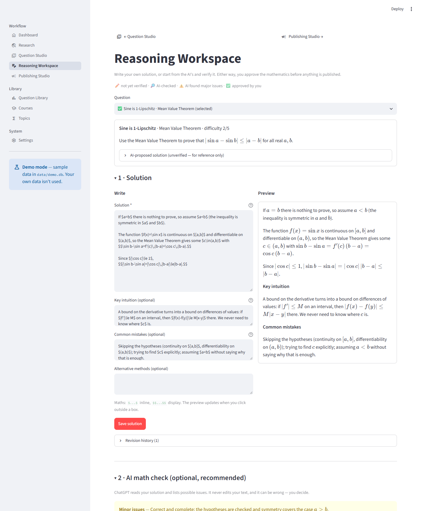
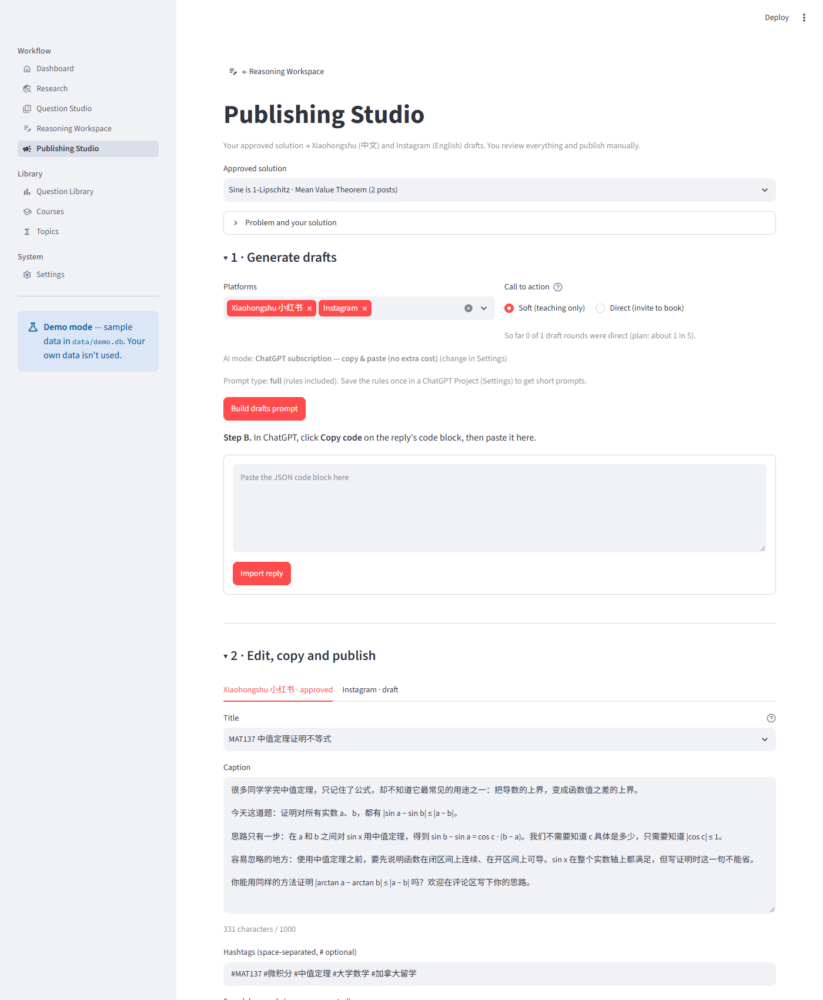
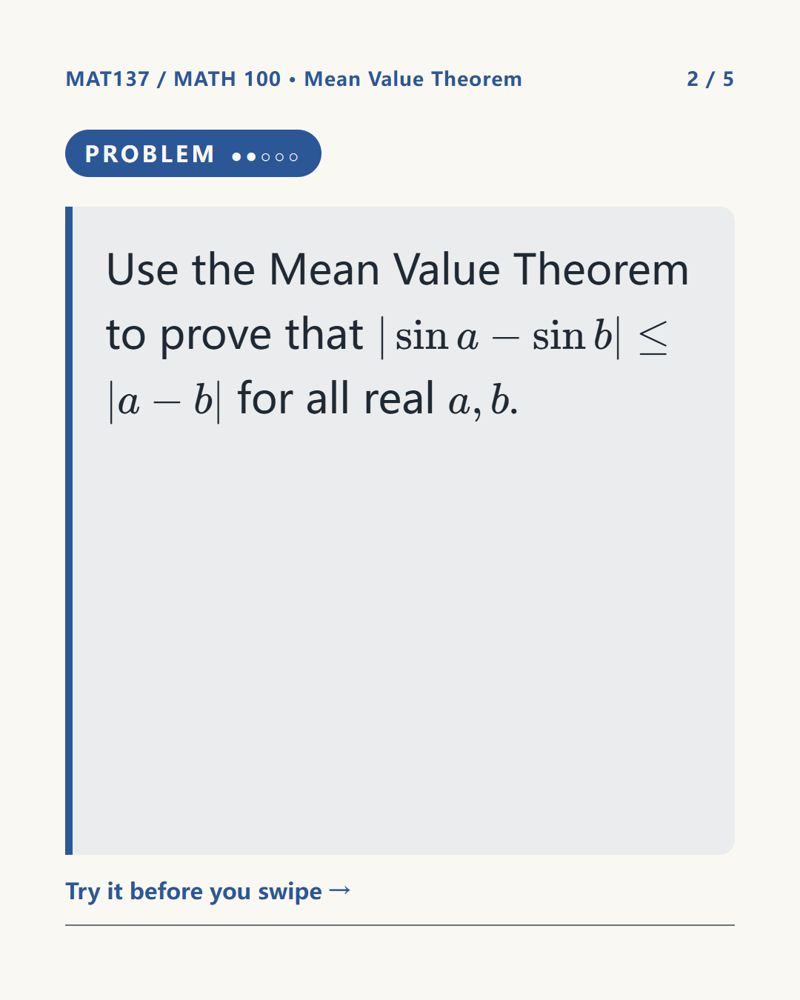
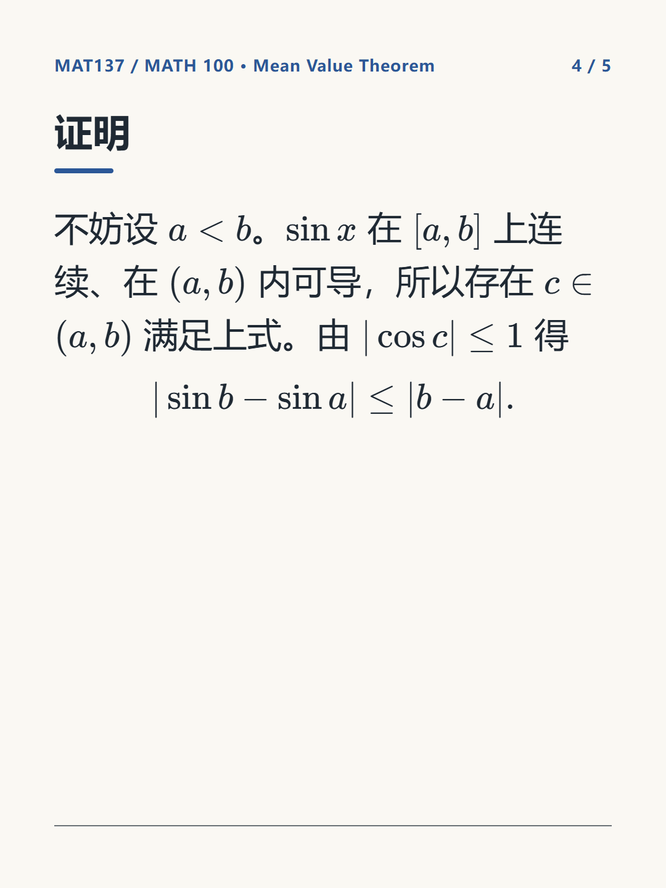

# Math Tutor Studio

An AI-assisted content pipeline for an independent university mathematics tutor: it finds what
students struggle with, drafts candidate problems, and turns the tutor's solutions into
bilingual social-media posts (Xiaohongshu in Chinese, Instagram in English) with rendered slides.

> **Try it with sample data:** double-click `start_demo.bat` (or see [Run](#run)). Demo mode uses a
> separate `data/demo.db` with fictional sources, three original questions, one verified solution and
> two finished drafts.



## The problem

Good mathematics content attracts tutoring students, but producing it every week (research, problem
writing, solutions, translation, captions, hashtags, graphics) takes more time than the tutoring itself.
This app automates that production so the tutor can be relieved from generating post ideas.

## How it works

1. **Research:** finds what students ask about (Mathematics Stack Exchange API) and which topics a
   course covers (uploaded syllabi, textbook contents, course pages).
2. **Topics:** ranks topics by course priority, evidence, timing and how recently they were used.
3. **Problems:** AI writes original candidate problems with solutions; the tutor picks one.
4. **Solution:** the tutor writes or edits the solution and approves it, optionally after an AI check.
   Posts carry the tutor's name, so this is the one step that stays with the tutor.
5. **Posts:** AI drafts the Chinese (Xiaohongshu) and English (Instagram) posts: titles, captions,
   hashtags and five slides, rendered as images.
6. **Publish:** the tutor posts manually.

### AI providers

Every AI step runs automatically through a provider API: **OpenAI**, **Anthropic (Claude)**,
**DeepSeek**, or any OpenAI-compatible service, chosen in Settings. Claude and OpenAI also receive
uploaded PDFs and images directly. Without an API key, a **copy-and-paste mode** does the same steps
through a ChatGPT subscription: the app builds the prompt and you paste the reply back (the app
starts in this mode until a key is added).

### Design notes
- **AI replies are checked before they are stored:** expected format, references to real topics and
  sources only, no duplicate problems.
- **Prompt rules live in versioned files** (`prompts/`), separate from the code.
- **Topic ranking is a simple weighted score** that the tutor can tune in Settings; with a few posts a
  week there isn't enough data to train anything.
- **Local-first:** SQLite with automatic schema upgrades; the only outside calls are research
  searches and AI requests.



| Rendered slide (Instagram) | Rendered slide (Xiaohongshu) |
|---|---|
|  |  |

## Run

Requires Python 3.11+.

```
python -m venv .venv
.venv\Scripts\python.exe -m pip install -r requirements.txt
```

- **Your own data:** `start.bat`, or `.venv\Scripts\python.exe -m streamlit run app.py`
- **Demo data:** `start_demo.bat`, or set `MTS_DEMO=1` before the same command
  (macOS/Linux: `MTS_DEMO=1 .venv/bin/python -m streamlit run app.py`)

The database (`data/tutoring.db`) is created and seeded automatically on first run.

**Slide images** use Microsoft Edge through Playwright (already present on Windows). On macOS/Linux,
run `python -m playwright install chromium` and set `slides.browser_channel: ""` in `config.yaml`.

**Your profile:** enter your real credentials in **Settings → Tutor profile** (stored in your local
database). `config.yaml` only holds placeholders.

## Workflow
1. **Research** — search Mathematics Stack Exchange per topic (official API); add course documents
   (upload a PDF/image, link, or paste) and let AI suggest topics from them.
2. **Question Studio** — tick ranked topics → AI proposes original problems → favourite / select / reject.
3. **Reasoning Workspace** — write your solution or start from the AI's and verify it → optional AI
   math check → your approval.
4. **Publishing Studio** — bilingual drafts (teaching-only or with an invitation) → edit → render slides
   → copy-ready text → publish manually → export.

## Tests

```
.venv\Scripts\python.exe -m pytest
```

About 120 tests: repository and migrations, reply validation, LaTeX handling, research (mocked HTTP),
ranking, drafts and review, uploads and provider routing (mocked SDKs, no API calls), real slide
rendering, and headless UI runs of every page.

## Code structure

See [STRUCTURE.md](STRUCTURE.md): layers, every file, database tables, AI tasks and statuses.

## How it was built

Built with **Claude Code as a pair programmer**: design decisions, requirements and review were the
author's; much of the implementation was written with AI assistance and verified through the test
suite and manual use.

## Status and next steps

Done: research, topic suggestions from course documents (incl. uploads), ranking, question generation,
reasoning workspace with AI math check, bilingual drafts, slide images, publishing studio, selectable
AI provider, demo mode.

Next: results tracking (post snapshots and anonymous inquiry outcomes) for a six-week trial, then
AI review of collected sources.
